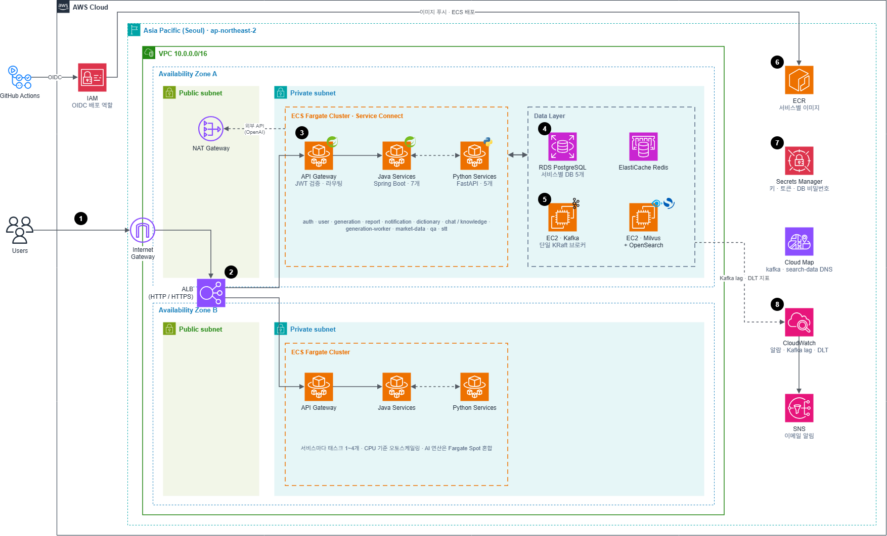
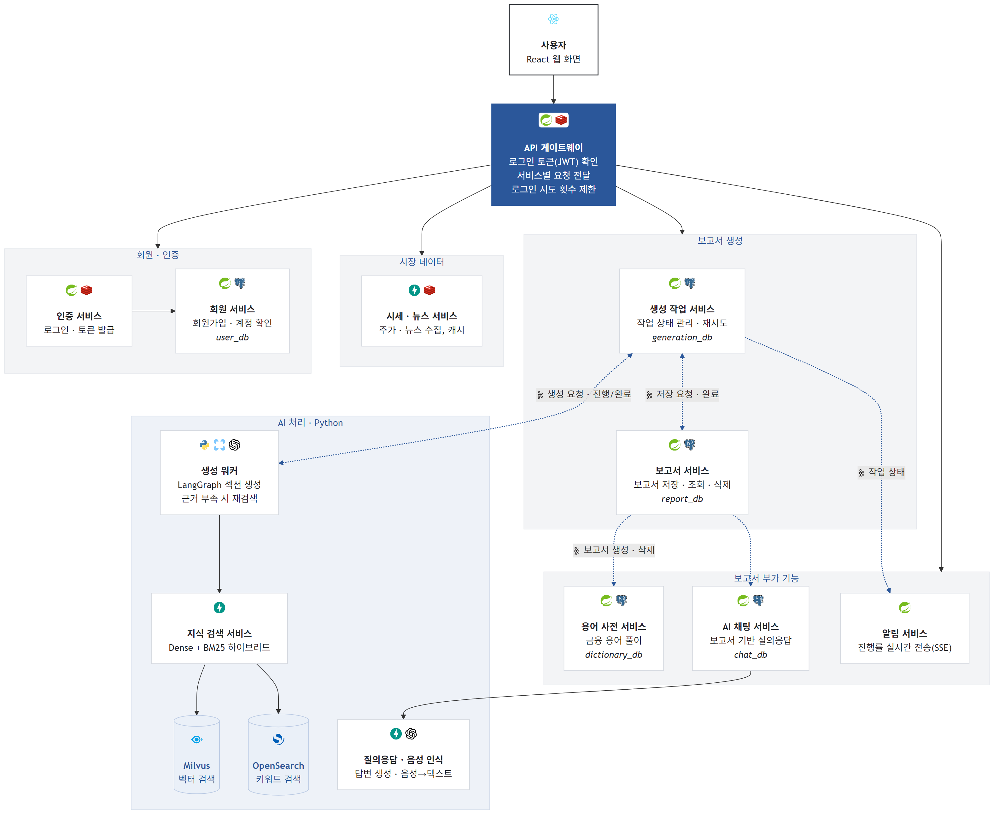
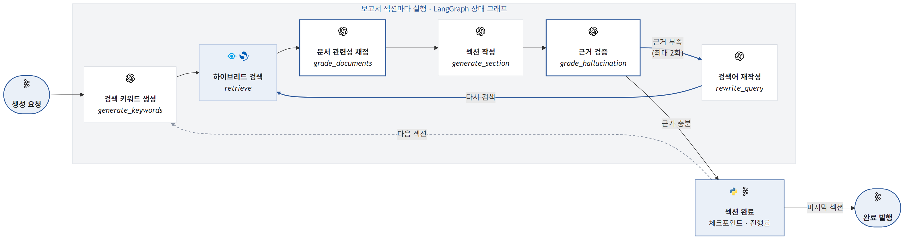
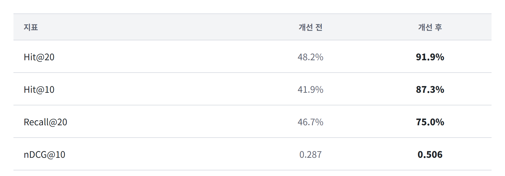

> 2025년 소프트웨어융합학과 졸업논문 | 개인 프로젝트 (기여도 100%)
> 기획·데이터 파이프라인·백엔드·프론트엔드·RAG 파이프라인·MSA 전환·AWS 인프라 설계(IaC) 전 과정 단독 수행
> 개발 기간: 2025.03 ~ 2025.12

## 프로젝트 소개

[서비스 시연 동영상 유튜브 링크](https://youtu.be/0xeEq4bg_60)

MyAnalyst는 기존 기업 분석 보고서가 가진 주관성, 정보의 비실시간성, 높은 접근 장벽의 문제점을 해결하기 위해 탄생한 RAG 기반 기업 분석 보고서 생성 서비스입니다.

사용자는 원하는 기업의 최신 공시 및 뉴스 데이터를 기반으로, 편향성이 배제된 객관적인 분석 보고서를 언제든지 직접 생성할 수 있습니다.  또한, 어려운 금융 용어를 설명해주는 용어 사전과 궁금증을 즉시 해결해주는 AI 비서 기능 등을 통해 누구나 쉽게 보고서를 이해하고 의사 결정에 활용할 수 있도록 돕습니다.

이를 통해 MyAnalyst는 금융 정보의 비대칭성을 해소하고, 모든 투자자가 신뢰할 수 있는 정보에 평등하게 접근하는 새로운 기준을 제시합니다.

## 프로젝트 배경

### 현행 기업 분석 보고서의 문제점

기업 분석은 특정 기업의 재무 상태, 비즈니스 모델, 경쟁력 등을 체계적으로 평가하여 해당 기업의 현재 및 미래 가치를 판단하는 과정입니다. 이를 기반으로 작성된 기업 분석 보고서는 증권사나 투자 리서치 기관의 전문가들이 투자자들에게 제공하는 중요한 자료입니다.

개인 투자자의 입장에서 기업 분석 보고서는 투자 전략을 수립하고 의사 결정을 내리는 데 중요한 역할을 합니다. 일반 투자자가 기업의 성장 가능성, 재무 안정성, 시장 트렌드를 직접 분석하는 것은 어렵기 때문에, 금융 전문가들이 작성한 보고서를 통해 주가 전망, 리스크 요인, 목표 주가 등 전문적인 정보를 얻습니다. 이를 통해 투자자는 보다 신뢰할 수 있는 데이터를 바탕으로 합리적인 결정을 내릴 수 있습니다.

그러나 현재의 기업 분석 보고서는 몇 가지 한계점이 존재합니다.

첫째로, 현재의 기업 분석 보고서는 분석자의 소속 기관, 투자 성향, 선호도 등에 따라 주관적인 견해가 포함될 가능성이 있습니다. 이는 투자자들이 객관적인 데이터를 바탕으로 판단하기 어렵게 만들고, 특정 분석가의 의견을 맹신하게 하는 부작용을 초래할 수 있습니다. 이로 인한 책임은 개인 투자자가 져야 하기 때문에, 개인 투자자에게는 더욱 객관적이고 중립적인 자료가 필요합니다.

둘째로, 정보의 최신성이 부족합니다. 대부분의 기업 분석 보고서는 분기(약 3개월) 단위로 발간되기 때문에, 시시각각 변화하는 투자 환경에 대한 실시간 반영이 어렵습니다. 특히 급변하는 금융 시장에서는 단기간 내에 중요한 정보가 바뀔 수 있어, 투자자가 시의적절한 결정을 내리기 어렵습니다.

셋째로, 높은 진입장벽이 있습니다. 기업 분석은 방대한 데이터를 수집하고 이를 해석하는 과정에서 많은 시간과 인력이 소요됩니다. 특히 금융 전문가의 경험과 인사이트가 중요한 요소로 작용하기 때문에, 일반 투자자들이 직접 기업 분석을 수행하기에는 높은 진입 장벽이 존재합니다. 이로 인해 금융 기관이나 투자 전문가의 기업 분석 보고서에만 의존할 수 밖에 없다는 한계가 있습니다.

이러한 한계를 극복하기 위해 이 프로젝트에서는 RAG(Retrieval-Augmented Generation) 기술을 활용하여, 보다 발전된 기업 분석 보고서를 생성하고자 합니다.

### RAG 기술을 적용하는 이유

RAG는 대규모 데이터를 빠르고 정확하게 검색한 후, 이를 바탕으로 LLM(Large Language Model)이 고도화된 분석을 수행하는 기술입니다. 이를 통해 기존의 기업 분석 방식에서 발생하는 문제점을 보완할 수 있습니다.

첫째로 기업 분석 보고서의 객관성을 강화할 수 있습니다. 기존의 분석 보고서는 작성자의 주관적 해석이 포함될 수 있지만, RAG를 활용하면 정량적인 데이터 분석을 기반으로 보다 객관적인 기업 평가를 수행할 수 있습니다.

둘째로, 기업 보고서에 들어가는 정보의 최신성을 보장할 수 있습니다.사용자가 원하는 시점에 즉시 기업 분석 보고서를 생성할 수 있어, 최신 데이터를 반영한 분석이 가능해집니다. 이는 기존 보고서의 주기적 발간 방식과 비교했을 때 정보의 정확성을 높이는 데 큰 장점이 됩니다.

셋째로 자원 소모가 절감되고 접근성이 향상됩니다. 웹 크롤링 및 LLM을 활용하여 방대한 데이터를 자동으로 수집하고 해석할 수 있어, 기존의 분석 과정에서 요구되던 높은 인력과 시간이 절감됩니다. 또한, 금융 전문가가 아닌 일반 투자자들도 쉽게 기업 분석 보고서를 생성하고 활용할 수 있습니다.

본 프로젝트는 이러한 RAG 기술의 강점을 활용하여 보다 효율적이고 신뢰할 수 있는 기업 분석 보고서를 제공하는 것을 목표로 합니다.

## 주요 기능

### 기업 분석 보고서 생성

기업 분석 보고서 생성 기능은 총 5단계의 마법사 스타일 인터페이스로 구성되어있습니다. 사용자는 전문성이 부족해도 해당 인터페이스의 단계를 따라가면서 쉽게 자신이 원하는 기업 분석 보고서를 생성할 수 있습니다.

1단계 : 기본 정보 입력

분석하고자 하는 기업명과 분석 기준 분기를 입력합니다.

현재 서비스는 셀트리온 기업의 24년 4분기만 제공하고 있습니다.

2단계 : 보고서 제목 설정

보고서에 표시될 제목을 설정할 수 있습니다.

기본 설정으로 날짜-기업명 형식으로 생성됩니다 (ex. 셀트리온 24년 4분기 기업 분석 보고서)

혹은 사용자의 입력을 통해 보고서의 제목을 임의로 지정할 수 있습니다.

3단계 : 보고서 목차 설정

보고서를 구성하는 목차를 설정할 수 있습니다.

필요치 않은 세부 목차를 제거하거나 필요한 목차를 추가할 수 있습니다.

기본 설정으로 보고서 요약, 실적 분석, 주요 사업 및 제품 동향, 시장 환경 및 전략 방향, 향후 전망으로 구성됩니다

4단계 : 관심 지표 설정

기업 분석 보고서를 생성할 때 분석에 집중할 경제 지표를 선택할 수 있습니다.

지표명 검색 창에서 원하는 지표를 검색하거나 주요 경제 지표 버튼을 통해 하나 이상의 경제 지표를 선택할 수 있습니다.

기본 설정으로 관심 지표 설정 없이 동등한 가중치로 분석하도록 합니다.

5단계 : 보고서 생성 확인

사용자의 입력 정보를 요약하여 생성하고자 하는 보고서가 맞는지 점검합니다.

보고서 생성 버튼을 눌러 기업 분석 보고서를 생성할 수 있으며, 이는 1분 정도의 시간이 소요됩니다.

### 보고서 읽기 도구

기업 분석 보고서를 생성한 후 이를 읽을 때 도움이 되는 4가지 도구들을 제공합니다. 사용자는 읽기 도구를 바탕으로 기업 분석 보고서 읽기 중 어려운 점을 쉽게 해결할 수 있습니다.

용어 사전 기능

기업 분석 보고서 내에 존재하는 어려운 금융 용어나 특정 도메인 용어의 뜻과 용례를 해설합니다.

해당 용어들은 기업 분석 보고서 내에 노란 배경으로 추가 표시되어 있습니다.

용어 사전에서 용어를 클릭하거나, 노란 배경의 글자를 클릭하는 것으로 용어 설명을 펼치고 접을 수 있습니다.

관련 뉴스 기능

네이버 뉴스에서 해당 기업의 실시간 관련 뉴스 상위 10개를 검색하여 가져옵니다.

각 뉴스는 제목과 초반 내용이 표시되며, 이를 클릭하여 실제 뉴스 페이지로 이동할 수 있습니다.

이를 통해 해당 기업의 최신 정보를 손쉽게 얻을 수 있습니다.

주식 정보 기능

네이버 증권에서 해당 기업의 실시간 주식 정보를 가져옵니다.

주식 정ana보에서 종목코드, 시가총액, 거래량 등의 기본적인 정보부터 PER, PBR 등의 전문적 경제 지표까지 볼 수 있습니다.

기업 분석 보고서와 현재 주식 정보를 통해 사용자는 주식 투자 의사 결정에 도움을 받을 수 있습니다.

질의응답 기능

나만의 금융 전문가 AI에게 기업 분석 보고서를 읽으며 궁금한 점을 질문할 수 있습니다.

질문은 채팅 형태로도, 음성 형태로도 가능합니다.

질문을 전달하면 금융 전문가가 기업 분석 보고서와 과거 데이터를 통해 RAG 기반으로 자세하게 답변합니다.

## 기술 스택

백엔드

- 언어: Java
- 프레임워크: Spring Boot, Spring Cloud Gateway(JWT RS256 검증)
- 이벤트: Spring Modulith(이벤트 레지스트리, Transactional Outbox), Apache Kafka
- 데이터베이스: PostgreSQL(서비스별 database), Redis
- 의존성 관리: Maven
- JSON 처리: ObjectMapper

프론트엔드

- 언어: JavaScript
- 프레임워크: React
- 상태 관리: React Hooks
- 라우팅: React Route
- 스타일링: Bootstrap 5, Bootstrap Icons
- 마크다운 렌더링: Marked

AI 서비스(Python)

- 언어: Python
- 프레임워크: FastAPI (knowledge, generation-worker, qa, stt, market-data)
- 벡터 데이터베이스: Milvus
- 파이프라인 오케스트레이션: LangGraph
- 검색: Dense(KLUE-BERT 임베딩) + Sparse(BM25, OpenSearch·KLUE-BERT WordPiece 토큰) 하이브리드, RRF 병합
- OCR 처리: Naver Clova OCR
- 자연어 처리: KoNLPy, KLUE-BERT

인프라

- 컨테이너: Docker, Docker Compose, AWS ECS Fargate
- 메시징: Apache Kafka (KRaft), Spring Modulith 이벤트 레지스트리(Transactional Outbox)
- IaC: Terraform (VPC/ECS/RDS/ElastiCache/ALB/Kafka EC2/관측성 등 모듈화)
- AWS: ECS Fargate(서비스 13개, Service Connect), ALB, RDS(PostgreSQL, 서비스별 database), ElastiCache(Redis), EC2(Kafka, Milvus·OpenSearch), ECR, Secrets Manager, CloudWatch, IAM(OIDC)
- CI/CD: GitHub Actions (OIDC 기반, 장기 AWS 액세스키 미사용)

## 인프라 아키텍처

## 기술적 도전과제

### 1. Spring Modulith를 이용한 MSA 구조 전환

**문제 상황**

하나의 Spring Boot 애플리케이션에서 인증, 보고서, 보고서 생성, 용어 사전, 채팅, 알림 기능이 서로 직접 호출하고 있었습니다. 이 때문에 한 기능의 장애나 배포가 전체 서비스에 영향을 줬습니다.

서비스를 분리하기 전에 모듈 간 의존성을 정리해야 했습니다. 모듈 경계를 검증하지 않은 채 분리하면, 미처 파악하지 못한 의존성 때문에 실행 중 오류가 발생할 수 있었습니다.

**설계와 구현**

- **모듈 간 의존성 정리 후 단계적 분리**

  Spring Modulith 테스트로 모듈 간 의존성을 검증했습니다. 모듈을 가로지르는 JPA 연관관계는 ID 참조로, 직접 호출은 이벤트로 바꿨습니다. 이후 이벤트로만 연결된 알림·용어 사전·채팅부터 분리하고, 보고서와 보고서 생성 기능을 마지막에 분리해 전체를 13개 서비스로 구성했습니다. 인증은 JWT RS256을 검증하는 API Gateway와 auth/user 서비스로 분리했습니다.

- **이벤트 발행과 장애 복구**

  Modulith 이벤트 레지스트리를 Outbox로 사용해 업무 데이터 변경과 이벤트를 같은 트랜잭션에 기록하고, 커밋 후 Kafka로 발행했습니다. 메시지 처리에 실패하면 지수 백오프로 재시도하고, 계속 실패하는 메시지는 DLT로 보내 후속 메시지 처리가 막히지 않도록 했습니다.

  보고서 저장에는 Saga를 적용했습니다. `생성 완료 → 저장 명령 → 저장 완료 이벤트 → Job 완료` 순서로 처리하고, 각 단계를 멱등하게 구현해 같은 이벤트나 명령이 다시 전달돼도 중복 저장되지 않도록 했습니다.

- **서비스별 데이터 관리**

  용어 사전과 채팅 서비스는 `report.created` 이벤트로 받은 데이터를 각자 저장하고, 이 사본으로 보고서 소유자를 확인합니다. 채팅 서비스는 보고서 본문도 보관하므로 보고서 서비스가 중단돼도 요청을 처리할 수 있습니다. 삭제 이벤트도 같은 compacted 토픽에 같은 보고서 ID를 키로 발행해, 이벤트를 처음부터 재처리하더라도 삭제된 보고서의 사본이 남지 않도록 했습니다.

  서비스별로 데이터베이스를 나누고 기존 데이터를 옮기는 마이그레이션 스크립트도 작성했습니다.

인프라는 Terraform으로 정의했습니다. 서비스별 ECS 서비스, ALB 뒤의 단일 Gateway, Kafka EC2, Secrets Manager와 컨슈머 지연·DLT 발생에 대한 CloudWatch 알람을 구성했습니다.

**검증 결과**

Docker Compose 환경에서 장애와 이벤트 재처리를 재현했습니다.

| 검증 항목 | 실험 조건과 결과 |
|---|---|
| 이벤트 재처리 | 보고서 200개를 생성하고 20개를 삭제한 뒤 채팅 서비스의 사본을 비우고 오프셋을 처음으로 되돌렸습니다. 메시지 228개를 재처리해 사본 182개를 복원했으며, 삭제된 보고서의 사본은 0개였습니다. 컨테이너 시작부터 처리 완료까지 7.7초가 걸렸습니다. |
| 보고서 서비스 장애 복구 | 보고서 서비스가 중단된 동안 Job은 `SAVING` 상태로 대기했습니다. 서비스 재시작 후 6.9초 만에 완료됐습니다. 이 시간에는 컨테이너 기동 시간이 포함됩니다. |
| 중복 저장 방지 | 동일한 생성 완료 이벤트를 3번 전달하고 저장 명령을 2번 추가 전달해도 보고서는 1개만 저장됐습니다. |
| 데이터 마이그레이션 | 공용 DB의 데이터를 서비스별 데이터베이스로 옮긴 뒤, 8개 테이블의 행 수가 원본과 일치하는지 확인했습니다. |

재처리 실험 당시 DB에는 기존 데이터를 포함해 보고서 183개가 있었습니다. 이 중 이벤트가 발행된 182개가 복원됐고, 이벤트 없이 저장한 1개는 복원 대상에 포함되지 않았습니다. 실험 조건과 로그는 [이벤트 재처리 검증](docs/msa/stage5/README.md)과 [저장 Saga·데이터 마이그레이션 검증](docs/msa/stage6/README.md)에 정리했습니다.

### 2. LangGraph 기반 RAG 파이프라인 설계

**문제 상황**

기존 파이프라인은 `키워드 생성 → 검색 → 생성`을 한 번만 실행했습니다. 검색 결과에 필요한 근거가 없거나 LLM이 근거에 없는 내용을 생성해도, 이를 확인하고 다시 검색하는 과정이 없었습니다.

보고서 생성에 수 분이 걸리는 동안 API 서버가 HTTP 응답을 기다리는 문제도 있었습니다. 생성 서버에 장애가 발생하면 사용자 요청도 실패했습니다.

**설계와 구현**

검색·생성 결과를 검증하는 흐름과, 오래 걸리는 생성 작업을 안정적으로 처리하는 구조를 각각 개선했습니다.

**검색 결과 평가와 재검색**

- LangGraph로 `generate_keywords → retrieve → grade_documents → generate_section → grade_hallucination` 흐름을 구성했습니다. 근거가 부족하다고 판단하면 `rewrite_query`에서 검색어를 다시 작성하고 재검색하도록 조건부 분기를 추가했습니다.
- 문서 관련성 평가는 검색 후보 전체를 한 번의 LLM 호출로 처리했습니다. 문서마다 호출할 때 후보 수만큼 비용이 늘어나는 문제를 줄이기 위한 선택입니다.
- 문서 관련성 평가나 생성 내용의 근거 검증 중 API 오류 등이 발생하면 생성을 계속하는 Fail-open 정책을 적용했습니다. 평가 기능의 장애로 보고서 생성 전체가 중단되는 것을 막기 위한 정책이며, 이 경우 해당 평가를 통과했는지는 확인하지 못합니다.

**비동기 생성과 장애 복구**

- 생성 요청을 Kafka로 전달하고 워커가 처리하도록 분리했습니다. 생성 작업은 별도 스레드에서 실행하고, 그동안 파티션을 `pause`한 상태로 `poll()`을 계속 호출합니다. 긴 작업 때문에 `max.poll.interval.ms`를 초과해 컨슈머 그룹에서 제외되는 문제를 방지했습니다.
- Job 상태를 변경할 때 현재 상태와 시도 번호를 확인해, 중복 전달된 이벤트나 이전 시도의 이벤트가 상태를 잘못 변경하지 않도록 했습니다.
- 섹션별 생성 결과를 체크포인트에 저장했습니다. 워커가 중단돼도 완료된 섹션을 복원하고 나머지부터 이어서 생성합니다. LLM 호출 오류는 답변 문자열로 반환하지 않고 예외를 발생시켜, 오류 문구가 정상 보고서로 저장되지 않고 백오프 후 재시도되도록 했습니다.

**검증 결과**

| 검증 항목 | 실험 조건과 결과 |
|---|---|
| 근거 부족 시 재검색 | 그래프를 실행해 `1차 생성 → 근거 부족 판정 → 쿼리 재작성 → 재검색 → 재생성 → 근거 통과 판정 → 종료` 순서로 동작하는지 확인했습니다. |
| 긴 작업 중 중복 처리 방지 | 최대 poll 허용 간격을 10초로 설정하고 20초 이상 걸리는 작업을 실행했습니다. poll 루프에서 동기 처리하는 컨슈머는 같은 메시지를 4번 재처리하고 다음 메시지로 넘어가지 못했습니다. 개선한 워커는 각 보고서를 한 번씩 처리했습니다. |
| 체크포인트 복원 | 섹션 생성 중 워커를 강제 종료한 뒤 재기동했습니다. 완료된 섹션을 복원하면서, 처음부터 생성할 때 22회였던 LLM 호출이 재기동 후에는 14회만 필요했습니다. |
| 검색 서비스 장애 복구 | 검색 서비스가 중단된 동안 시도 1·2가 실패했고, 서비스 복구 후 시도 3에서 성공했습니다. |

### 3. RAG 검색 품질 개선

**문제 상황**

기존 검색은 Milvus의 Dense 벡터 검색만 사용했습니다. 금융 문서에는 금액, 기업명, 재무 지표가 자주 등장하는데, 의미 기반 검색만으로는 `252억6000만원`, `IQVIA`처럼 특정 키워드가 중요한 문서를 놓쳤습니다. 반대로 단어 일치에만 의존하면 `항암제 마케팅 시너지`를 `암 치료제 묶음 판촉`처럼 바꿔 표현한 질의를 처리하기 어려웠습니다.

생성 파이프라인에는 LLM이 만든 키워드와 재검색 과정에서 다시 작성한 질의가 모두 들어옵니다. 두 유형을 함께 처리할 검색 방식과, 개선 효과를 비교할 평가 기준이 필요했습니다.

**설계와 구현**

검색 결과 상위 20개를 LLM이 다시 평가하므로, **정답 문서가 후보 20개 안에서 누락되지 않는 것**을 우선 목표로 삼았습니다.

- **Dense와 BM25를 결합한 하이브리드 검색**

  KLUE-BERT 임베딩과 Milvus로 의미가 비슷한 문서를 찾고, OpenSearch의 BM25로 키워드가 일치하는 문서를 찾도록 했습니다. 두 검색 결과는 점수 체계가 달라, 점수를 직접 합산하지 않고 각 검색 결과의 순위를 사용하는 RRF로 병합했습니다.

  가중치는 1:1로 설정했습니다. BM25에 2배 가중치를 주는 실험에서는 Dense 검색만으로 찾은 문서가 최종 후보에 포함되지 않아, BM25 단독 검색과 같은 후보만 남았기 때문입니다.

- **한국어 토큰화 개선**

  OpenSearch 기본 분석기는 `252억6000만원으로`와 `252억6000만원`을 서로 다른 토큰으로 처리해 검색에 실패했습니다. 이미 임베딩에 사용하던 KLUE-BERT WordPiece 토크나이저를 재사용해, 색인할 문서와 검색 질의를 동일한 방식으로 토큰화했습니다.

- **BM25 인덱스 관리 방식 변경**

  워커마다 전체 문서를 메모리에 올리던 `rank_bm25` 인덱스를 OpenSearch로 옮겼습니다. 워커 간 메모리 중복 사용을 줄이고, 워커를 재시작하지 않아도 새 문서를 검색에 반영하도록 했습니다.

- **동일한 데이터로 검색 방식 비교**

  뉴스 기사에서 규칙에 따라 정답 문장을 선정하고, 원문 표현·키워드·다르게 표현한 질문의 세 유형으로 질의를 만들었습니다. 같은 보도자료에서 나온 유사 문장은 중복을 제거했습니다. 이 데이터로 Dense 단독, 토큰화 전후 BM25, 가중치·임베딩 모델별 하이브리드 검색을 비교했습니다. 자체 평가 데이터의 편향을 보완하기 위해 사람이 정답을 라벨링한 공개 벤치마크에서도 평가했습니다.

검색 장애에 대한 처리도 보완했습니다. `HYBRID_SEARCH_ENABLED` 설정으로 Dense 단독 검색으로 전환할 수 있고, Sparse 검색이 실패하면 Dense 결과로 자동 폴백합니다. IVF_FLAT 인덱스 생성 시 검색용 파라미터인 `nprobe`를 사용하던 오류와 데이터 삽입 후 `flush` 누락도 수정했습니다.

**검증 결과**

 지표 | 기존 Dense 검색 | 하이브리드 검색 |
---|---:|---:|
 Hit@10 | 41.9% | **87.3%** |
 Hit@20 | 61.1% | **85.3%** |
 Recall@20 | 46.7% | **75.0%** |
 nDCG@10 | 0.287 | **0.506** |

Hit@k는 상위 k개 결과에 정답이 하나 이상 포함된 질의의 비율입니다. Recall@20은 전체 정답 문서 중 상위 20개에서 찾은 비율이고, nDCG@10은 상위 10개의 순위까지 반영한 지표입니다.

개선 폭의 95% 신뢰구간은 +39.8~+47.4%p였습니다. 두 데이터 모두 Dense 단독 검색과 비교했을 때 하이브리드 검색 도입이 통계적으로 유의했습니다

**개선 효과와 한계**

- **BM25가 효과적이었던 이유**

  평가 대상은 같은 기업을 다룬 뉴스가 많아, 주제가 비슷하더라도 서로 다른 제품이나 실적을 설명하는 문서를 구분해야 했습니다. 이런 데이터에서는 기업명·제품명·금액처럼 질의에 포함된 구체적인 표현이 정답 문서를 찾는 중요한 단서가 됩니다. BM25가 이 단어 일치를 검색에 반영하면서 기존 Dense 검색의 누락을 보완한 것으로 해석했습니다. 실제로 WordPiece를 적용한 BM25 단독의 자체 데이터 Hit@20은 90.9%로, 기존 Dense 검색의 48.2%보다 높았습니다.

- **한국어 토큰화가 뒷받침한 단어 일치**

  BM25도 문서와 질의를 서로 다른 토큰으로 처리하면 같은 단어를 찾지 못합니다. WordPiece로 양쪽을 동일하게 토큰화해 조사나 어형 차이로 인한 검색 누락을 줄였습니다. 이 수정만으로도 공개 벤치마크의 BM25 Hit@20이 63.5%에서 84.5%로 올랐습니다.

- **Dense 검색을 함께 유지한 이유**

  질의를 원문과 다른 표현으로 작성하면 단어 일치만으로 찾기 어려운 문서가 생깁니다. 자체 데이터의 해당 질의에서 BM25 단독의 Hit@20은 77.0%였고, Dense 검색을 결합하면 82.0%로 올랐습니다(p=0.014). Dense 검색이 BM25가 놓친 정답을 후보에 추가하는 데 도움이 된 결과입니다.
- **기존 임베딩 모델의 영향**

  비교 대상인 Dense 검색은 `klue/bert-base`의 토큰 임베딩을 평균한 벡터를 사용했습니다. 따라서 이번 격차에는 검색 방식뿐 아니라 임베딩 모델의 영향도 있습니다. 한국어 문장 임베딩 모델로 교체한 하이브리드 검색에서는 공개 벤치마크의 nDCG@10이 0.506에서 0.689로 올랐습니다. 이를 다음 개선 방향으로 확인했으며, 현재 적용된 구성의 성능과는 구분했습니다.

